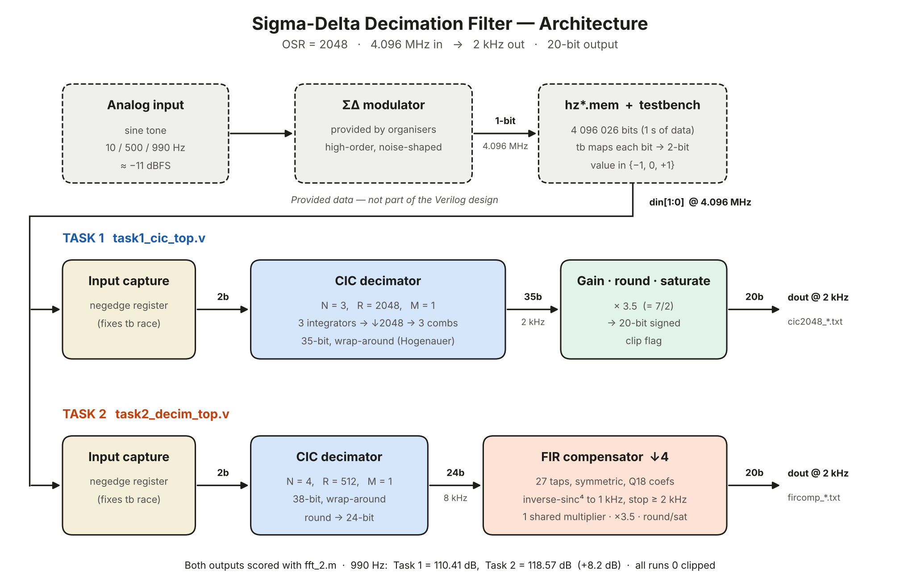

# Digital Decimation Filter for a Sigma-Delta ADC (OSR 2048, 20-bit)

Submission for the **Digital Decimation Filter Design Challenge**: Electronics Club, IIT Guwahati, VLSI track.
Author: Rahul Jain, B.Tech ECE, IIT Guwahati.

The input is a sigma-delta bit stream at 4.096 MHz. The output is a 20-bit signed word at 2 kHz, covering a 0–1 kHz signal band.

| Tone | **Task 1**: CIC only (N=3, R=2048) | **Task 2**: CIC (N=4, R=512) + 27-tap FIR ↓4 |
|---:|---:|---:|
| 10 Hz  | 120.68 dB | 121.20 dB |
| 500 Hz | 118.61 dB | 117.66 dB |
| 990 Hz | 110.41 dB | **118.57 dB** (+8.2 dB) |

The SNDR is measured with the official `fft_2.m` on the Vivado xsim behavioural-simulation outputs. No output sample saturated in any run.

## Repository structure

```
rtl/                      synthesizable Verilog (the design)
  cic_decimator.v         parameterised N-stage CIC decimator (used by both tasks)
  fir_decim_comp.v        27-tap symmetric FIR droop compensator, decimate by 4, 1 multiplier
  task1_cic_top.v         TASK 1 top: input capture + CIC (N=3, R=2048, gain 3.5)
  task2_decim_top.v       TASK 2 top: input capture + CIC (N=4, R=512) + FIR (↓4)
tb/
  tb_task1.v, tb_task2.v  testbenches derived from the provided template (set `define TONE)
matlab/
  fft_2.m                 official scoring script (hann() written out, so no toolbox is needed)
  snr_*.m, run_all_snr.m  the scoring script for each of the 6 output files, plus a summary
  design_fir.m            reproduces the FIR coefficients
  fir_coeffs_q18.txt      integer coefficients used in the RTL (Q18)
  fir_coeffs_float.txt    unquantised coefficients (unity DC gain)
results/
  outputs/*.txt           simulation outputs (2000 samples each)
  *.png                   MATLAB PSD plots, filter responses, architecture diagram
report/
  Decimation_Filter_Lab_Report_v1.pdf
```

## Architecture



* **Task 1.** A single CIC with N = 3, R = 2048, M = 1 and 35-bit wrap-around registers. The output gain is 7/2, followed by round-half-up and 20-bit saturation.
* **Task 2.**
  * CIC with N = 4, R = 512 and 38-bit registers, producing a 24-bit interstage word at 8 kHz.
  * A 27-tap least-squares inverse-sinc⁴ FIR (Q18 coefficients) that decimates by 4.
  * The FIR uses a pre-adder and a single shared multiplier, giving a 20-bit output at 2 kHz.
  * Combined passband ripple is 0.043 dB up to 990 Hz, and alias rejection is about 59 dB.

## How to run (Vivado)

1. Add the four `rtl/*.v` files as **design sources**.
2. Add `tb/tb_task1.v` or `tb/tb_task2.v`, plus the provided `hz10.mem`, `hz500.mem` and `hz990.mem`, as **simulation sources**.
3. In the testbench, set `` `define TONE `` to 10, 500 or 990.
4. Set the top to `tb_task1` or `tb_task2`, run the behavioural simulation, then type `run all`. The run covers about 410 ms of simulated time and ends with `$finish`.
5. The output file `cic2048_<TONE>.txt` (Task 1) or `fircomp_<TONE>.txt` (Task 2) is written to `<project>.sim/sim_1/behav/xsim/`.
6. Copy the output files into `matlab/` and run `run_all_snr` (or a single `snr_*.m` script).

The `.mem` input files are the ones provided with the problem statement.
